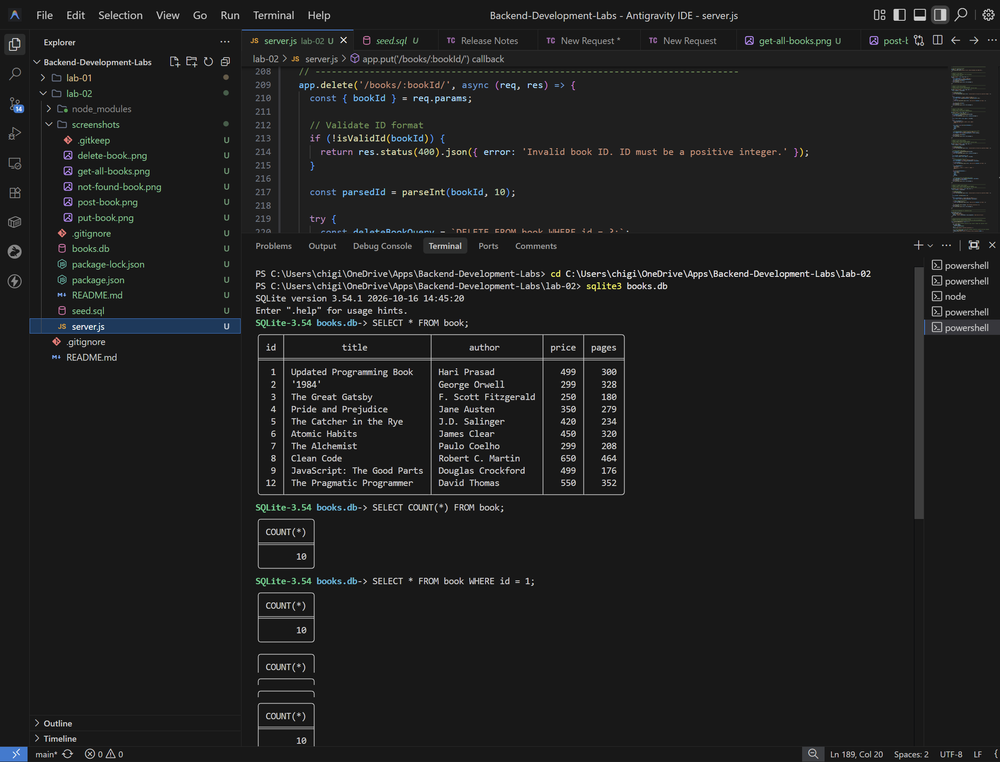
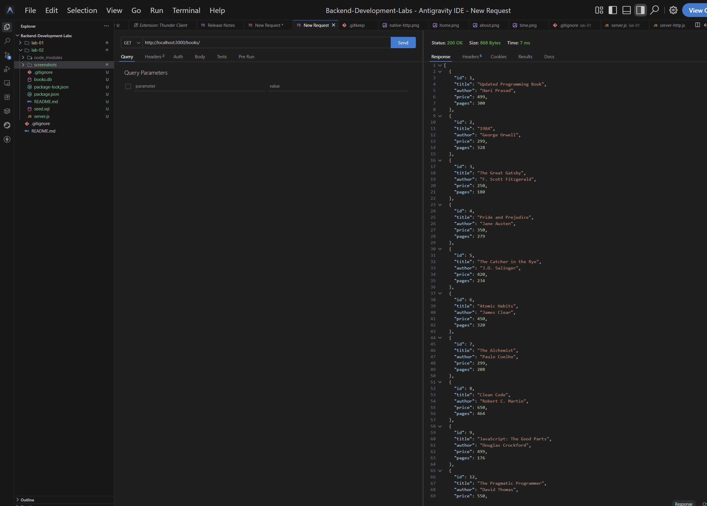
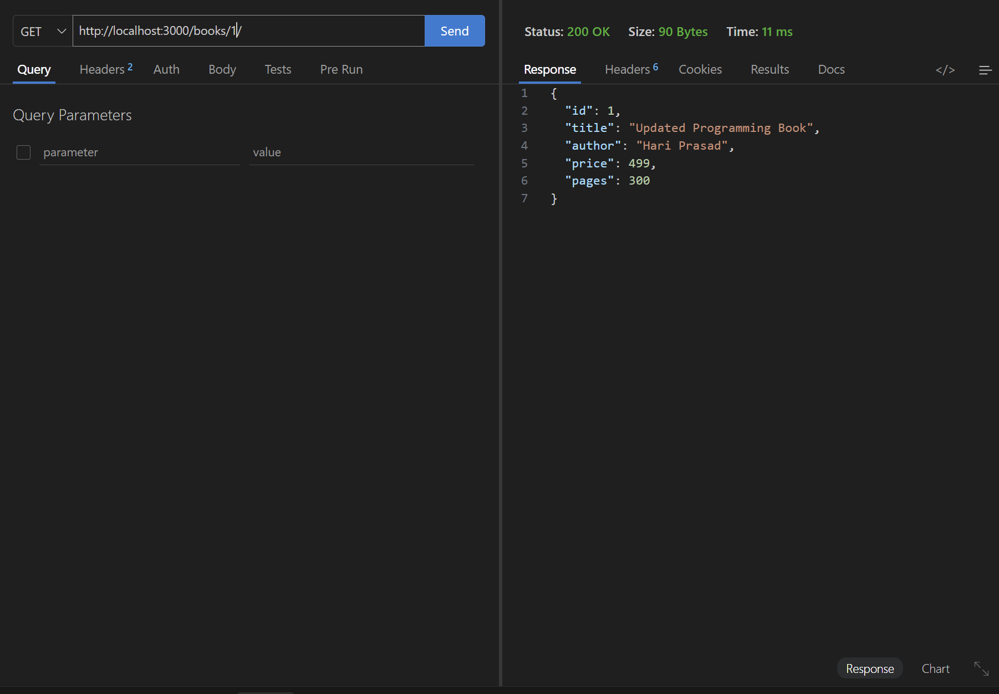
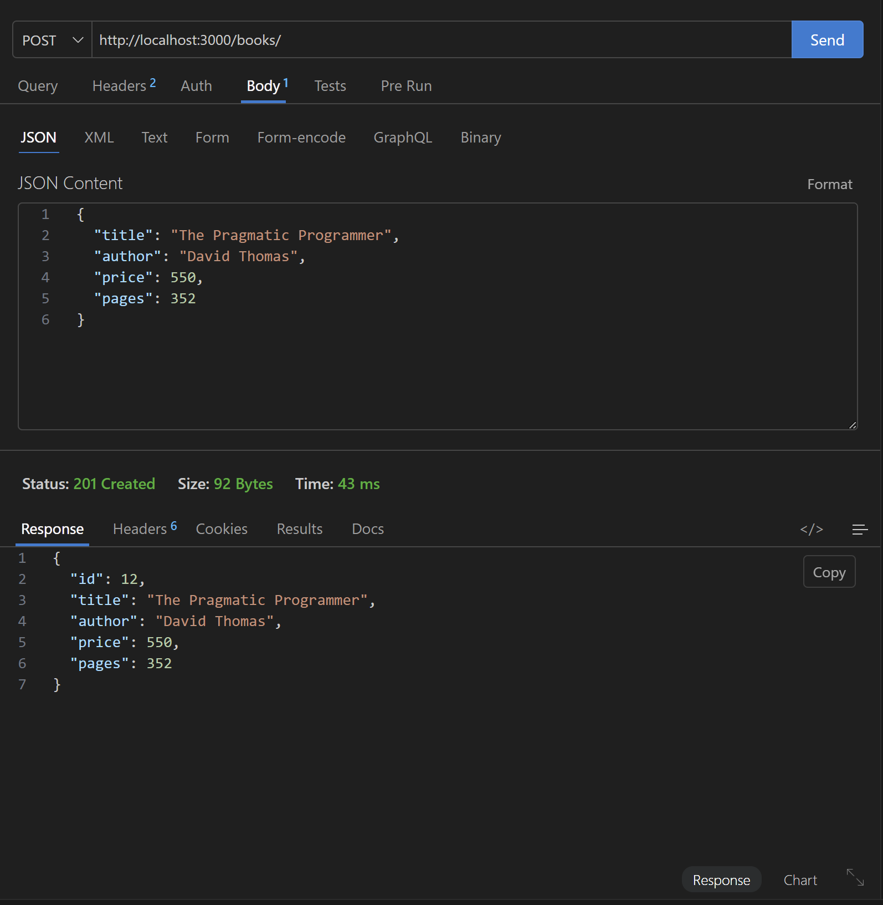
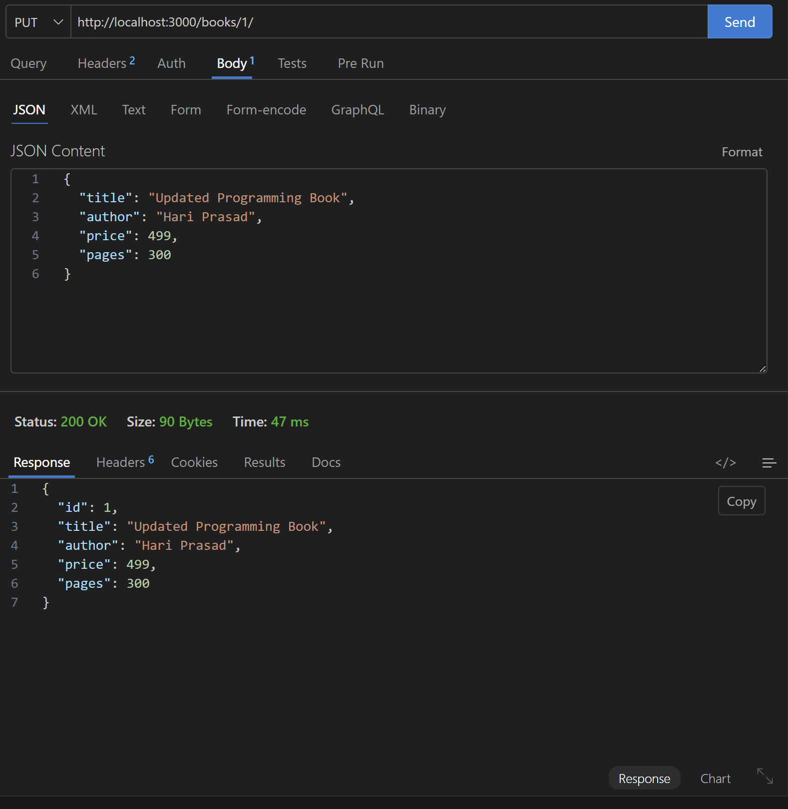
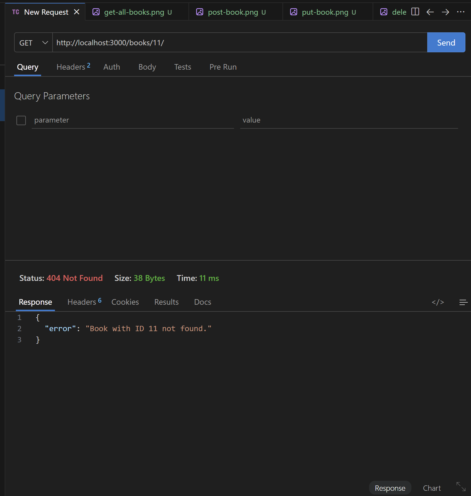

# Lab 2: SQLite Database and CRUD Routes

**Course:** Backend Development Fundamentals  
**Academic Year:** II Year, Term II  
**Institution:** Aurora Deemed to be University  
**Faculty:** Mr Sai Siva Teja Chintakrindi  

---

## 1. Student Information
- **Student Name:** Bogam Hari Prasad
- **Registration Number:** 252U1R1036
- **Section:** CSE-2A
- **Course:** Backend Development Fundamentals
- **Academic Year:** II Year, Term II
- **Institution:** Aurora Deemed to be University
- **Faculty:** Mr Sai Siva Teja Chintakrindi

---

## 2. Project Objective
The objective of this lab is to build a robust, beginner-friendly RESTful API in Node.js and Express that connects to a local SQLite database (`books.db`) and performs complete CRUD (Create, Read, Update, Delete) operations using asynchronous functions, parameterized SQL queries, and proper HTTP response status codes.

---

## 3. Technologies Used
- **Node.js** (JavaScript runtime environment)
- **Express.js** (Minimalist web framework for routing and middleware)
- **SQLite3** (Lightweight, serverless, file-based relational database engine)
- **sqlite** (Promise-based asynchronous wrapper around sqlite3 for clean `async/await` syntax)
- **nodemon** (Development utility that automatically restarts the Node server upon code changes)
- **SQLite CLI (`sqlite3.exe`)** (Official command-line tool to initialize, seed, and inspect the database)

---

## 4. Project Folder Structure

```text
lab-02/
Γö£ΓöÇΓöÇ server.js              # Express server with async initialization and 5 CRUD endpoints
Γö£ΓöÇΓöÇ books.db               # SQLite database file containing the 'book' table and data
Γö£ΓöÇΓöÇ seed.sql               # SQL script creating table and seeding 10 initial book records
Γö£ΓöÇΓöÇ package.json           # Dependencies, scripts (start, dev), and project metadata
Γö£ΓöÇΓöÇ package-lock.json      # Dependency lockfile ensuring reproducible builds
Γö£ΓöÇΓöÇ README.md              # Comprehensive lab documentation and report
Γö£ΓöÇΓöÇ .gitignore             # Excludes node_modules, .env, and logs (keeps books.db)
ΓööΓöÇΓöÇ screenshots/           # Directory containing captured output screenshots
    ΓööΓöÇΓöÇ .gitkeep           # Index placeholder for screenshots
```

---

## 5. Installation Instructions

### Prerequisites
- **Node.js** (v18 or higher recommended)
- **npm** (Node Package Manager)

### Step-by-Step Setup
1. Open terminal and navigate to the `lab-02` directory:
   ```bash
   cd lab-02
   ```
2. Install all required dependencies:
   ```bash
   npm install
   ```

---

## 6. SQLite CLI Installation Instructions (Windows)

The SQLite Command-Line Interface (`sqlite3`) allows you to run SQL scripts and inspect database tables directly from PowerShell or Command Prompt.

If typing `sqlite3 --version` returns an error (`command not found`), install it following these steps:

1. Visit the official SQLite download page: [https://www.sqlite.org/download.html](https://www.sqlite.org/download.html).
2. Under **Precompiled Binaries for Windows**, download the **sqlite-tools-win-x64-*.zip** bundle.
3. Extract the ZIP file. Inside, you will find `sqlite3.exe`.
4. Copy `sqlite3.exe` to a folder included in your Windows system `PATH` (such as `C:\Users\<YourUsername>\.local\bin` or create `C:\sqlite` and add it to your System Environment Variables under `Path`).
5. Open a new terminal and verify the installation:
   ```bash
   sqlite3 --version
   ```
   *Expected output:* `3.54.1 ...` (or current SQLite version).

---

## 7. Database Initialization and Seeding

The database file `books.db` is initialized and populated with 10 sample books using the official SQLite CLI:

```bash
# Execute the seed script into books.db
sqlite3 books.db ".read seed.sql"
```

### Table Schema (`book` table):
| Column | Data Type | Constraints | Description |
| :--- | :--- | :--- | :--- |
| `id` | `INTEGER` | `PRIMARY KEY AUTOINCREMENT` | Unique identifier for each book |
| `title` | `TEXT` | `NOT NULL` | Title of the book |
| `author` | `TEXT` | `NOT NULL` | Author of the book |
| `price` | `INTEGER` | `NOT NULL` | Price in INR (positive integer) |
| `pages` | `INTEGER` | `NOT NULL` | Number of pages (positive integer) |

### Verification via SQLite CLI:
```bash
sqlite3 books.db -header -column "SELECT * FROM book;"
```
*Confirm that exactly 10 initial records are returned.*

---

## 8. Execution Commands

| Command | Action | Description |
| :--- | :--- | :--- |
| `npm start` | `node server.js` | Starts the Express server on port 3000 (or `process.env.PORT`) |
| `npm run dev` | `nodemon server.js` | Starts the server with hot-reloading for development |

---

## 9. API Endpoints Reference Table

| HTTP Method | Endpoint URL | Description | Expected Status |
| :--- | :--- | :--- | :---: |
| **GET** | `/books/` | Retrieve all books from database | `200 OK` |
| **GET** | `/books/:bookId/` | Retrieve a single book by ID | `200 OK` / `400` / `404` |
| **POST** | `/books/` | Create and insert a new book | `201 Created` / `400` |
| **PUT** | `/books/:bookId/` | Update all editable fields of an existing book | `200 OK` / `400` / `404` |
| **DELETE** | `/books/:bookId/` | Delete an existing book by ID | `200 OK` / `400` / `404` |

---

## 10. Example Request Bodies and Testing Details

### 1. GET All Books
- **URL:** `http://localhost:3000/books/`
- **Method:** `GET`
- **Expected Status:** `200 OK`
- **Response:** JSON array of 10 book objects.

### 2. GET Single Book
- **URL:** `http://localhost:3000/books/1/`
- **Method:** `GET`
- **Expected Status:** `200 OK`
- **Response:**
  ```json
  {
    "id": 1,
    "title": "To Kill a Mockingbird",
    "author": "Harper Lee",
    "price": 399,
    "pages": 281
  }
  ```

### 3. GET Non-Existent Book (404 Test)
- **URL:** `http://localhost:3000/books/999/`
- **Method:** `GET`
- **Expected Status:** `404 Not Found`
- **Response:**
  ```json
  {
    "error": "Book with ID 999 not found."
  }
  ```

### 4. POST New Book
- **URL:** `http://localhost:3000/books/`
- **Method:** `POST`
- **Headers:** `Content-Type: application/json`
- **Request Body:**
  ```json
  {
    "title": "Atomic Habits",
    "author": "James Clear",
    "price": 450,
    "pages": 320
  }
  ```
- **Expected Status:** `201 Created`
- **Response:** Newly created book record with generated `id`.

### 5. PUT Update Book
- **URL:** `http://localhost:3000/books/1/`
- **Method:** `PUT`
- **Headers:** `Content-Type: application/json`
- **Request Body:**
  ```json
  {
    "title": "To Kill a Mockingbird (Special Edition)",
    "author": "Harper Lee",
    "price": 499,
    "pages": 300
  }
  ```
- **Expected Status:** `200 OK`
- **Response:** Updated book record.

### 6. DELETE Book
- **URL:** `http://localhost:3000/books/10/`
- **Method:** `DELETE`
- **Expected Status:** `200 OK`
- **Response:**
  ```json
  {
    "message": "Book deleted successfully"
  }
  ```

### 7. Input Validation Error Tests (400 Bad Request)
- **Invalid ID:** `GET /books/abc/` -> Returns `400 Bad Request` (`Invalid book ID. ID must be a positive integer.`).
- **Missing/Invalid Fields:** `POST /books/` with `{ "title": "" }` -> Returns `400 Bad Request` (`Field 'title' must be a non-empty string.`).

---

## 11. SQLite CLI Verification Commands

After performing API requests, verify changes directly in the database:

1. **Verify all records:**
   ```bash
   sqlite3 books.db -header -column "SELECT * FROM book;"
   ```
2. **Verify a single record after POST or PUT:**
   ```bash
   sqlite3 books.db -header -column "SELECT * FROM book WHERE id = 1;"
   ```
3. **Verify record count after DELETE:**
   ```bash
   sqlite3 books.db "SELECT COUNT(*) FROM book;"
   ```

---

## 12. Screenshots

> *Capture real screenshots from your SQLite CLI terminal and Postman, and save them into the `screenshots/` directory.*

### 1. Database Records (`SELECT * FROM book;` in SQLite CLI)


### 2. GET All Books (`GET /books/`)


### 3. GET Single Book (`GET /books/1/`)


### 4. POST New Book (`POST /books/`)


### 5. PUT Update Book (`PUT /books/1/`)


### 6. DELETE Book (`DELETE /books/10/`)


### 7. 404 Route / Book Not Found (`GET /books/999/`)


---

## 13. Deployment Information & SQLite Cloud Persistence Limitations

- **Deployment Status:** https://lab-02-67zg.onrender.com

### Important Note on SQLite Persistence on Cloud Platforms:
SQLite is a serverless, embedded database engine that stores all data inside a single local file (`books.db`). Most cloud application platforms (such as Render Free Tier, Heroku, or Vercel) utilize **ephemeral filesystems** inside stateless virtual containers.
- Every time a cloud service restarts, rebuilds, or goes to sleep after inactivity, the container filesystem is restored to its original Git commit state.
- Consequently, any new books created via `POST`, updated via `PUT`, or removed via `DELETE` in production will be reset unless a persistent cloud volume is mounted (e.g., Render Persistent Disks) or an external database (such as PostgreSQL, MySQL, or Turso) is connected.

---

## 14. Problems Faced and Solutions

### Problem 1: SQLite CLI Unavailable on Windows
- **Issue:** Running `sqlite3 --version` in Windows PowerShell initially failed because SQLite CLI was not pre-installed or present in the system `PATH`.
- **Solution:** Downloaded the official `sqlite-tools-win-x64` precompiled package from `https://sqlite.org`, extracted `sqlite3.exe` to a user directory registered in `PATH` (`~/.local/bin`), and verified version `3.54.1`.

### Problem 2: SQL Injection Vulnerability in User Input Queries
- **Issue:** Constructing SQL queries using string concatenation (e.g., ``WHERE id = ${bookId}``) allows attackers to execute unauthorized SQL statements.
- **Solution:** Enforced parameterized SQL queries across all route handlers using `?` placeholders (e.g., `WHERE id = ?`), ensuring parameters are safely bound by the SQLite engine.

### Problem 3: Handling Database Asynchrony Before Server Starts
- **Issue:** If Express starts listening for incoming HTTP requests before the database connection is established, early requests crash with null pointer errors.
- **Solution:** Enclosed database opening and server listening in a single `initializeDBAndServer()` function, utilizing `await open(...)` and starting `app.listen()` only after the database connection resolves successfully.

---

## 15. Viva Voce Preparation Questions & Answers

### Question 1: What is the difference between `db.all()`, `db.get()`, and `db.run()`?
- **`db.all(query, params)`:** Executes a `SELECT` query and returns **all matching rows** as a JavaScript array of objects. Used in `GET /books/`.
- **`db.get(query, params)`:** Executes a `SELECT` query and returns **only the first matching row** as a single JavaScript object (or `undefined` if not found). Used in `GET /books/:bookId/`.
- **`db.run(query, params)`:** Executes `INSERT`, `UPDATE`, or `DELETE` statements that modify the database. It does not return rows; instead, it returns an object containing metadata:
  - `result.lastID`: The auto-incremented ID of the row inserted.
  - `result.changes`: The number of rows affected/modified by the query.

### Question 2: Why do we use parameterized queries (`?` placeholders) instead of string concatenation?
- **Security (Prevents SQL Injection):** String concatenation allows malicious input (such as `1; DROP TABLE book;`) to alter the SQL logic. When using `?` placeholders, the SQLite driver treats the input strictly as literal data, preventing injection attacks.
- **Performance:** Parameterized queries allow the database to compile and cache the SQL execution plan once and reuse it efficiently with different parameter values.
- **Automatic Escaping:** Quotes, apostrophes, and special characters in book titles or authors are handled automatically without syntax errors.

### Question 3: What is the role of the `sqlite3` driver versus the `sqlite` wrapper package?
- **`sqlite3` (Core Driver):** The official C-based native Node.js driver for SQLite. It is callback-based (uses `(err, row) => ...`), which can lead to nested callback hell.
- **`sqlite` (Promise Wrapper):** A lightweight library that wraps the callback-based `sqlite3` driver in modern JavaScript Promises. It allows developers to use clean `async/await` syntax with `open()`, `db.all()`, `db.get()`, and `db.run()`.

